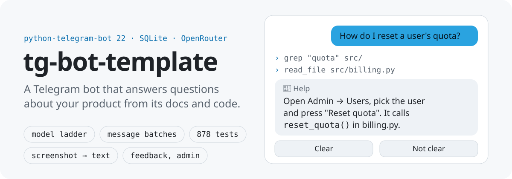

# tg-bot-template

<p align="center">
  <picture>
    <source media="(prefers-color-scheme: dark)" srcset="docs/assets/hero.svg">
    
  </picture>
</p>

<p><a href="README.md">English</a> | <b>Русский</b></p>

Шаблон Telegram-бота на Python, который отвечает на вопросы о вашем продукте по его документации и
исходному коду. Работает на python-telegram-bot 22 и SQLite, с моделями говорит через OpenRouter (или
локальный шлюз OmniRoute). Из коробки: лестница запасных моделей, пачки сообщений, скриншот в текст,
отзывы, доступ и команды админа; всё это покрыто 878 тестами. Новое поведение добавляется отдельным
модулем режима.

Шаблон для разработчиков, которым нужен бот поддержки или внутренний бот вопросов и ответов по
продукту и не хочется самим строить обвязку вокруг вызова модели. Шаблон выделен из рабочего бота.
Новый бот - это копия шаблона по чеклисту ниже ([ADR-0006](docs/adr/0006-template-is-a-copy.md)),
механизма обновления копий нет.

## Чем отличается

- **От голого каркаса на python-telegram-bot или aiogram.** Каркас даёт обработчики и поллинг. Здесь
  есть и то, что начинается после первого ответа модели: медленные и бракованные ответы, несколько
  сообщений как один вопрос, скриншоты, ответы, которые не заглядывали в документацию, расход по сессии,
  коды инцидентов и просмотр журнала админом.
- **От облачных конструкторов ботов без кода.** Бот читает ваш настоящий репозиторий инструментами
  `read_file` / `grep` / `glob` и работает на вашем сервере, так что код и ключи остаются у вас. Цена -
  деплой и сопровождение на вас (systemd-юнит и скрипт обновления в комплекте).
- **Чем не является.** Это не библиотека и не фреймворк, а заготовка, которую копируют и меняют.

## Что внутри

**Режимы.** В каждый момент у пользователя активен один режим (термины - в `CONTEXT.md`):

- **Справка** - режим по умолчанию. Ответ простым языком по каталогам `TGBOT_KNOWLEDGE_DIRS` и клону
  `TGBOT_REPO_URL`: модель читает их инструментами `read_file` / `grep` / `glob`. Под ответом кнопки
  "Понятно / Не понятно": по второй бот объясняет проще ещё раз, а после второй попытки предлагает
  передать вопрос людям Отзывом.
- **Эхо** (`/echo`) - демо-режим: повторяет текст и считает шаги. Это образец для своего режима,
  в настоящем боте его убирают.

**Общая механика**, которую получает любой режим:

- **Пачки сообщений.** Сообщения подряд склеиваются в один вопрос (окно `TGBOT_TEXT_DEBOUNCE_S`).
  Сообщение, пришедшее, пока готовится ответ, - позднее: ответ уходит сразу, под ним пометка и кнопка
  "Ответить с учётом новых". Любая команда отбрасывает открытую пачку.
- **Скриншот в текст.** Фото или файл PNG/JPG/WEBP один раз распознаётся в текст моделью из
  `TGBOT_VISION_MODELS` (ADR-0005), дальше идёт тем же путём, что текст. В одной пачке до 10 картинок.
- **Реакции.** Сообщение, принятое в пачку, бот отмечает реакцией.
- **Лестница моделей** через OpenRouter (ADR-0003, ADR-0004): основная модель, по порогу времени
  или после брака параллельно подключаются запасные, побеждает первый годный ответ. Пороги по классам
  вызова - `TGBOT_LLM_<CLASS>_STEPS_S`.
- **Проверки ответа.** Выродившийся ответ (обрывки слов, смешение алфавитов) ловят регулярки,
  пограничные случаи решает классификатор Jev (typesafe.ai, `TYPESAFE_API_KEY`). Тот же Jev
  классифицирует намерение: болтовня идёт дешёвым вызовом без инструментов, а просьба о другом режиме
  даёт кнопку перехода под ответом Справки. Без ключа Jev классификатора намерения нет, а из проверки
  на вырождение остаются только регулярки.
- **Непроверенный ответ.** Ответ, в котором модель ни разу не обратилась к файлам (ни чтением, ни поиском)
  или инструменты были сняты, приходит с пометкой
  и не кэшируется.
- **Кэш ответов агента** в SQLite (`TGBOT_AGENT_CACHE_TTL_S`), сброс - `/cache_clear`.
- **Коды инцидентов и журнал.** При сбое пользователь видит короткий код и кнопку "Сообщить
  разработчикам". Журнал событий - в SQLite и зеркалом в JSONL-файлы по сессиям (`TGBOT_LOGS_DIR`)
  с ротацией по размеру каталога. Админам приходит пуш о таймаутах, браке и ошибках обработчиков.
  Журнал процесса (stderr, journald) несёт `[u=<user> upd=<update>]` в каждой строке и маскирует
  токены и ключи.
- **Доступ.** Админы - из `ADMIN_USER_IDS`, остальные - по allowlist. Чужой пользователь может
  подать заявку `/request_access`, админы решают кнопками. Бот только для себя - `TGBOT_OWNER_ONLY=1`:
  пускает лишь `ADMIN_USER_IDS`, чужим молчит, заявок нет.
- **Отзывы.** `/support <текст>` записывает отзыв, `/feedback` показывает админам непрочитанные,
  по рабочим дням в 15:00 (Asia/Almaty; `TGBOT_REMINDER_HOUR`, `TGBOT_REMINDER_TZ`) админам уходит
  напоминание о непрочитанных.
- **Языки** ru и en: `/language`, до выбора - по профилю Telegram. Если человек пишет на другом
  языке, бот предлагает переключиться.
- **Простой язык** (`docs/simple-language.md`): правила в промптах, чистка текста модели кодом,
  тест-линтер статичных текстов и pre-commit, который убирает типографский юникод.

**Команды.** Всем допущенным: `/start`, `/help`, `/echo`, `/support`, `/language`, `/whoami`.
До допуска: `/whoami`, `/request_access`, `/language`. Админам дополнительно:

| Команда | Что делает |
|---|---|
| `/allow <user_id или @username>` | добавить в allowlist |
| `/deny <user_id или @username>` | убрать из allowlist |
| `/users` | админы и allowlist |
| `/cost [session_id]` | расход токенов и $ по сессии (по умолчанию - последней своей) |
| `/cache_clear` | сбросить кэш ответов агента |
| `/logs` | файлы журнала в чат, с листанием |
| `/feedback [all]` | непрочитанные отзывы с кнопками "Прочитано" и "Лог сессии"; `all` - последние 10 |

## Архитектура

Пакет `src/tgbot`:

| Модуль | Что в нём |
|---|---|
| `__main__` | старт: конфиг, файловая блокировка (один поллер), журнал `startup`, клон репозитория, `run_polling` |
| `bot` | сборка `Application`: `Deps` в `bot_data`, регистрация команд и кнопок |
| `config` | `Config` и `load_config`: env плюс файлы `./.env`, `/opt/tg-bot/.env` (или `TGBOT_ENV_FILE`), `~/.env` |
| `handlers/deps` | `Deps` (общие зависимости и состояние процесса), `ModeSpec`, `get_deps`, `user_lang` |
| `handlers/registry` | реестр режимов кроме Справки (`MODES`) |
| `handlers/reference` | Справка, вход свободного текста, пачки, журнал апдейтов |
| `handlers/echo` | демо-режим `/echo`, образец режима |
| `handlers/modes` | кнопка перехода в режим под ответом Справки |
| `handlers/{admin,access,support,language,common}` | админские команды, доступ и заявки, отзывы и напоминания, язык, `/start` `/help` и меню |
| `modes`, `mode_switch` | шапка "режим · этап" и предложения перехода |
| `reference_mode` | промпты и короткий контекст диалога Справки |
| `agent/` | `ladder` (лестница), `openrouter` (транспорт), `tools` (чтение файлов), `cache`, `failures`, `result`, `stages` |
| `intent`, `degeneration`, `jev` | классификатор намерения, проверка на вырождение, клиент Jev |
| `packs`, `screenshot_input`, `vision` | пачки сообщений, вход картинок, распознавание скриншотов |
| `repo` | клон и `git pull` репозитория `TGBOT_REPO_URL` |
| `db`, `journal`, `logs_view` | SQLite (сессии, пользователи, отзывы, заявки, расход, кэш), файловый журнал, вывод `/logs` |
| `access`, `alerts`, `i18n` + `locales/`, `utils`, `logging_setup` | allowlist, пуш админам, тексты ru/en, отправка длинных сообщений и HTML, журнал процесса |

Хендлеры - функции `async def name(update, context)`, зависимости берут через `get_deps(context)`.
Если в корне есть `docs/howto.md`, его текст попадает в промпт Справки как инструкция к боту.

## Чеклист "новый бот"

1. Скопировать шаблон без `.git`, `.venv`, `*.db`, `logs/`, `.env*`:
   `rsync -a --exclude .git --exclude .venv --exclude '*.db' --exclude logs --exclude '.env*' tg-bot-template/ my-bot/`
2. `cd my-bot && git init`.
3. Назвать бота: имя и описание в BotFather, тексты в `src/tgbot/locales/{ru,en}.py` (`START`,
   `CMD_DESCRIPTIONS`, `REFUSAL`), `name` и `description` в `pyproject.toml`, имя продукта для
   промптов - `TGBOT_PRODUCT_NAME`.
4. `.env` из `deploy/env.example`: `TELEGRAM_BOT_TOKEN`, `OPENROUTER_API_KEY`, `TYPESAFE_API_KEY`,
   `ADMIN_USER_IDS`, `TGBOT_KNOWLEDGE_DIRS`, `TGBOT_REPO_URL`.
5. Завести отдельного тестового бота для разработки и `.env.e2e` (`tests_e2e/README.md`).
   Прод-токен живёт только на сервере.
6. `git config core.hooksPath .githooks` - pre-commit чистит типографский юникод и, если стоит
   `gitleaks`, не пускает коммит с секретом.
7. `uv sync --extra dev && uv run pytest`.
8. Деплой: systemd-юнит по `deploy/DEPLOY.md`.
9. Когда появится первый свой режим - убрать `/echo`: `echo.SPEC` из `handlers/registry.py`, модуль
   `handlers/echo.py`, его тексты в locales (`ECHO_*` и ключи `echo`) и тесты, которые на него опираются
   (`rg -l echo tests tests_e2e`).

## Как добавить режим

1. Скопировать `src/tgbot/handlers/echo.py` в `handlers/<режим>.py`. Задать `MODE`, функции входа
   `enter(deps, message, lang, user_id, text)` и шага `text_step(deps, message, lang, session, text)`,
   обработчики команды и кнопок, и `SPEC = ModeSpec(mode, intent, command, callback_prefix,
   command_handler, callback_handler, enter, text)`. `intent` - критерий для классификатора: какая
   просьба ведёт в этот режим.
2. Добавить `<режим>.SPEC` в `handlers.registry.MODES`.
3. Тексты в `locales/ru.py` и `locales/en.py`: `MODE_HEADERS` (шапка со значком), `MODE_GO` (кнопка
   перехода), `MODE_STAGES` (этапы), `CMD_DESCRIPTIONS` (описание команды) и свои строки режима.
   Наборы ключей двух локалей должны совпадать (`tests/test_i18n.py`).

Остальное берётся из реестра: команда и кнопки (`bot`), место в меню (`handlers.common`), метка и
критерий классификатора (`intent`), текст при открытой сессии (`handlers.reference`) и вход по кнопке
перехода (`handlers.modes`). Вход в режим открывает сессию (`db.open_mode_session`), выход - закрывает
(`db.close_mode_session`); номер шага хранится в `sessions.step`. Шаг пишите через
`db.advance_session` (как `echo.text_step`): он не оживит сессию, которую закрыли, пока шаг шёл.

Ловушки:

- имя режима (`MODE`) не `chat` и не `question`: это метки классификатора Справки (`intent`);
- префикс кнопок (`callback_prefix`) не пересекается с занятыми: `lang:`, `logs:`, `fb_`, `fail:`,
  `pack:redo:`, `access:`, `ref:`, `mode:`, `echo:` - обработчик выбирается по началу `callback_data`;
- команда не совпадает с существующей (`bot.COMMAND_HANDLER_NAMES`, команды других режимов);
- каждый новый ключ текста - в обеих локалях (`ru.py` и `en.py`), иначе падает `tests/test_i18n.py`.

## Настройки

Переменные окружения. На сервере их подставляет systemd (`EnvironmentFile`), при локальном запуске
`load_config` сам добирает незаданные из `./.env`, `/opt/tg-bot/.env`, `~/.env` (первое найденное
значение; окружение процесса сильнее файла). Деплой-путь `/opt/tg-bot/.env` заменяет `TGBOT_ENV_FILE`.
Пример - `deploy/env.example`.

| Переменная | По умолчанию | Что задаёт |
|---|---|---|
| `TELEGRAM_BOT_TOKEN` | - (обязательна) | токен бота из BotFather |
| `ADMIN_USER_IDS` | пусто | user_id админов через запятую |
| `TGBOT_DB_PATH` | `./tgbot.db` | файл SQLite; рядом с ним каталог клона `repo` |
| `TGBOT_KNOWLEDGE_DIRS` | `docs` | каталоги, которые читает Справка, через запятую; относительные - от рабочего каталога |
| `TGBOT_REPO_URL` | нет | git-репозиторий продукта (`https://`, `ssh://`, `file://`, `git@host:path`): клон на старте, `git pull --ff-only` перед ответом Справки. Доступ - лучше deploy key (ssh) или read-only токен; токен из `https://<токен>@...` бот передаёт git заголовком через окружение, в `.git/config` клона он не попадает |
| `TGBOT_PRODUCT_NAME` | нет ("этот продукт") | имя продукта в промптах Справки |
| `OPENROUTER_API_KEY` | нет | ключ OpenRouter; без него бот работает, но ответов модели и распознавания скриншотов нет |
| `OPENROUTER_MODEL` | `z-ai/glm-5.3-flash` | лестница: до трёх моделей через запятую, первая основная; больше трёх роняет старт |
| `TGBOT_VISION_MODELS` | `google/gemini-3.1-flash-lite,google/gemini-3.8-flash` | модели распознавания скриншотов, до трёх; `:free` роняет старт |
| `TGBOT_LLM_PROVIDER` | `openrouter` | `openrouter` или `omniroute`; другое роняет старт |
| `OMNIROUTE_API_KEY` | нет | ключ OmniRoute (страница Endpoint шлюза); нужен при `omniroute`, им же распознаются скриншоты |
| `OMNIROUTE_MODEL` | нет | лестница моделей шлюза (до трёх, имена OmniRoute: `if/...`, combo); при `omniroute` обязательна. Задайте и `TGBOT_VISION_MODELS` именами шлюза |
| `TGBOT_OWNER_ONLY` | нет | `1` - бот только для `ADMIN_USER_IDS`: allowlist и `/request_access` выключены, чужим молчание; пустой `ADMIN_USER_IDS` роняет старт |
| `TYPESAFE_API_KEY` | нет | ключ Jev: пограничные случаи вырождения и классификатор намерения |
| `TGBOT_TEXT_DEBOUNCE_S` | `2.0` | окно склейки пачки, секунды; `0` - без пачек |
| `TGBOT_REMINDER_TZ` | `Asia/Almaty` | часовой пояс напоминания об отзывах (имя IANA); неизвестный роняет старт |
| `TGBOT_REMINDER_HOUR` | `15` | час напоминания об отзывах (пн-пт), 0-23; другое роняет старт |
| `TGBOT_AGENT_CACHE_TTL_S` | `86400` | срок жизни кэша ответов агента, секунды; `0` - кэш выключен |
| `TGBOT_LLM_FULL_STEPS_S` | `120,240,600` | пороги лестницы для полного вызова: вторая модель, третья, сбой |
| `TGBOT_LLM_REFERENCE_STEPS_S` | `120,240,600` | то же для вопроса Справке |
| `TGBOT_LLM_LIGHT_STEPS_S` | `20,40,60` | то же для лёгкого вызова (болтовня) |
| `TGBOT_LOGS_DIR` | `./logs` | каталог файлового журнала (JSONL) |
| `TGBOT_LOGS_MAX_BYTES` | `1073741824` (1 ГиБ) | потолок размера каталога журнала; не целое число роняет старт |
| `TGBOT_LOCK_PATH` | `TGBOT_DB_PATH` с расширением `.lock` | файл блокировки: второй экземпляр с той же базой не стартует |
| `TGBOT_LOG_LEVEL` | `INFO` | уровень журнала процесса |
| `TGBOT_ENV_FILE` | `/opt/tg-bot/.env` | путь деплой-файла окружения в списке файлов `load_config` (другой каталог бота) |
| `TELEGRAM_BOT_API_BASE_URL` | `https://api.telegram.org/bot` | адрес Bot API (тестовый DC, фейк в тестах) |
| `TGBOT_LLM_BASE_URL` | нет | префикс OpenAI-совместимого API, включая `/v1`: адрес OmniRoute (по умолчанию `http://localhost:20128/v1`) или фейк в тестах |

Пороги лестницы - три возрастающих положительных числа через запятую, опечатка роняет старт.
`TGBOT_LOGS_DIR`, `TGBOT_LOGS_MAX_BYTES`, `TGBOT_LOCK_PATH` и `TGBOT_LOG_LEVEL` читаются из окружения
процесса, а не из `.env`-файлов: локально их задают в окружении, на сервере - в `.env` юнита.
`TGBOT_ENV_FILE` - тоже только из окружения процесса: путь к файлу нужен до его чтения, в самом файле ключ
ничего не меняет.

## Локальный запуск

```bash
uv sync --extra dev
cp deploy/env.example .env   # токен ТЕСТОВОГО бота, ключи
uv run python -m tgbot
```

`bash deploy/restart.sh` перезапускает локальный процесс одной командой (останавливает прошлый по
pid-файлу в `logs/`). Один токен - один поллер: прод-токен локально не запускать.

## Тесты

- `uv run pytest -q` - unit-тесты и слой Bot API (`tests/botapi`: настоящий процесс бота против
  фейкового Telegram и фейкового LLM, `tests/fakes`).
- Покрытие: `uv run --with pytest-cov pytest --cov=tgbot --cov-report=term-missing`.
- True E2E на тестовом DC Telegram через Telethon - `deploy/e2e.sh`, настройка в `tests_e2e/README.md`.
- `ruff check --select F src tests tests_e2e extra_scripts` (ruff ставится отдельно, в `dev` его нет).

CI гоняет unit-тесты и ruff на каждый push и pull request; отдельный workflow проверяет всю историю
git на секреты через gitleaks.

## Известные ограничения

- Сессия режима не истекает сама: выход - кнопкой режима или `/start`.
- Память процесса по пользователям (диалоги Справки, отказы доступа, поставленные меню, открытые сессии Справки)
  не чистится до перезапуска; при сотнях пользователей это килобайты.
- Фоновые задачи пачек при остановке не дожидаются: пачка, которая собиралась в момент остановки, теряется.
- Юнит `deploy/tg-bot.service` без усиления изоляции. Рекомендуется drop-in с `NoNewPrivileges=yes`,
  `ProtectSystem=strict`, `ReadWritePaths=/opt/tg-bot/data` (каталог БД, клона и журнала); `.env` держать
  `root:root 600` - systemd читает `EnvironmentFile` от root.

## Деплой

`deploy/DEPLOY.md`: первый деплой (systemd-юнит `deploy/tg-bot.service`), обновление
`deploy/update.sh`, частые проблемы.

## Документы

- `CONTEXT.md` - глоссарий.
- `docs/adr/` - решения: лестница моделей, только OpenRouter, скриншот в текст, шаблон-копия.
- `docs/simple-language.md` - как бот пишет для человека.
- `openspec/specs/` - спеки поведения, единственная подробная документация механики.

## Участие и безопасность

См. [CONTRIBUTING.ru.md](CONTRIBUTING.ru.md) и [SECURITY.ru.md](SECURITY.ru.md). Об уязвимостях сообщайте
приватно, не в issues.
